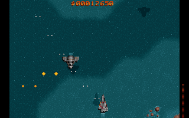
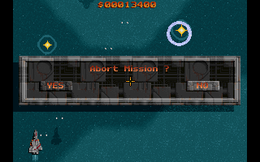
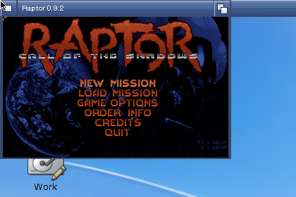

# Raptor: Call of the Shadows for AmigaOS 3.x / AmiCradle — TESTING

Raptor: Call of the Shadows (Cygnus Studios, 1994) is a vertical
shoot-'em-up drawn at 320x200. This repository holds skynettx's open engine,
reconstructed from the DOS game by nukeykt and others (GPL-2.0, `LICENSE`),
as imported from upstream
[skynettx/raptor](https://github.com/skynettx/raptor) at
`746c35a256bfa2afc6732c7923be9e2e777d6bf0` (identical file for file; upstream's
own README is `README.upstream.md`), and the AmiCradle port around it:
68040 + FPU, libnix, SDL2 through GFOpenGPU, OpenAmigaGCC 16.2.0-open3 or
open4. There is no network code.

The engine needs the original game data, which is not part of this
repository and never committed: see *Game data*.

## Building

The port never edits the imported tree: `build-amiga.sh` copies `src/` and
the two libraries upstream carries in `include/` (textscreen, for the setup
screens, and TinySoundFont), applies `patches/` in order with no fuzz (every
change is Amiga-only, under `__amigaos__`), and compiles upstream's source
list (`CMakeLists.txt`, setup included). It writes `Raptor/raptor`,
`Raptor/LICENSE`, `build.log` and `receipt.json` (the compiler, the patch and
SDK digests and the executable's SHA-256).

Through Cradle (the build the lab tests use): `stove_build` with the stove
`os32-gcc16`, target `.` for the program and target `runtime-data` for the
game data. From a checkout with a staged stove:

```sh
STOVE=/path/to/os32-gcc16 OUT=build-amiga sh build-amiga.sh
OUT=build-data sh runtime-data/build-amiga.sh
```

`build-amiga.sh` takes 16.2.0-open3 (compiler archive SHA-256
`9fcc136ab59e3bb5b91d2764d0bf290b709d72d7380be4ce0cdf005edf8eff21`) and
16.2.0-open4 (`495319a2ffd803278f8827cad70074029c7aa9ecbe05d037e8646ba43ab94ab2`,
Cradle's `os32-gcc16` stove since 2 November 2026) and refuses any other.
Receipts of the builds recorded here are in `receipts/`.

## Game data

Raptor needs `FILE0000.GLB` and `FILE0001.GLB` from the shareware episode
(version 1.2; the full game's `FILE0002.GLB` to `FILE0004.GLB` work too, put
beside them). The shareware episode was released by Apogee for free
distribution: its `VENDOR.DOC` lets anyone copy and pass it around without
charging for it, all files unmodified (CD-ROM, bundle and retail
distribution need Apogee's written permission).

`runtime-data/build-amiga.sh` fetches Apogee's `1rap12.zip` on the PC that
runs it, checks it and the two GLB files inside against the SHA-256 values
pinned in `gameports/runtime-data.json` (with where the file comes from and
why it is taken to be the publisher's release), and puts them in
`Raptor/` with `VENDOR.DOC`. Nothing is redistributed: the data stays
external, as the manifest's policy says.

## Running

Put `raptor` and `LICENSE` in a drawer with `FILE0000.GLB` and
`FILE0001.GLB` beside them (`runtime-data/build-amiga.sh` stages exactly
that) and start `raptor` from a Shell with a stack of 256 KB or more
(`Stack 262144`; SDL2 needs it). The game reads its data from `PROGDIR:`,
wherever it is started from. It needs a 68040 or 68060 with its FPU,
GFOpenGPU's `SDL2.module` and, for sound, AHI.

Everything the game writes goes in `PROGDIR:User` (`patches/0001`), made on
the first run: `SETUP.INI` (the settings upstream's README describes, written
with the defaults on the first run) and the saves. `setup_menu=0` is the
Amiga default, so the game starts straight away as `RAP.EXE` did;
`setup_menu=1` in `PROGDIR:User/SETUP.INI` brings back upstream's text-mode
start screen and setup.

### Display

The game draws 320x200. With `fullscreen=1` (the default) it opens a screen
of its own in the display mode closest to 320x200 (`patches/0002`), and
Alt+Return goes between that screen and a Workbench window of exactly
320x200. The frame goes to the screen without upstream's intermediate
upscaled texture. `aspect_ratio_correct=1` stretches it to 320x240 instead.
`SetEnv RAPTOR_FPS 1` logs the frames shown every five seconds (a file name
instead of `1` adds the lines to that file). Quitting shows upstream's
text-mode ending screen in a window until a key is pressed.

### Controls

Keyboard (upstream's defaults, kept in `PROGDIR:User/SETUP.INI`): the arrow
keys move, Ctrl fires, Alt fires the special weapon, Space changes the
special weapon, Right Shift drops a mega bomb, P pauses, Escape opens the
in-flight menu ("Abort Mission ?") and leaves menus, F1 is help, and in the
hangar S saves the pilot. Menus also take Return, the arrow keys and the
mouse; the hangar is worked with the mouse pointer. Alt+Return switches
screen and window.

Joysticks and pads come through SDL from GFOpenInput (lowlevel.library
where GFOpenInput isn't installed); the game lists the ones it found when
it starts (`Pad 0: ...`). `patches/0003` makes them work without changing
the control setting: in keyboard mode (`Control=0`, the default) a pad plays
alongside the keyboard, its d-pad or stick steering when no arrow key is
held and its buttons firing (A fire, B special, X change special, Y mega,
the shoulders change special and mega); `joy_ipt_MenuNew=1` is the Amiga
default, so the d-pad, A and B drive the menus. A CD32 pad has no Back
button, which the game uses for the in-flight menu: hold both shoulders
and press Play. `Control=2` is upstream's joystick-only mode.

## Observed 2 November 2026: input and the first wave (step 3)

Commit `2fe304a` (patches 0001 to 0003), Cradle `stove_build`, open4:
executable SHA-256
`31e5954b43d7f58cd6667299199032e6064b592996d3b0e3ffedbbd7e6fc8355`
(`receipts/3-input-open4-stove_build.json`); `tests/lab` built HoldKeys.
Same lab and `SDL2.module` as step 2, `PROGDIR:User` cleared first.

- Keyboard in menus: Return on New Mission, the name and callsign typed
  into the pilot form, Up and Return for the difficulty (Rookie), Escape out
  of the credits and the hangar, the quit question answered with Return.
  The mouse pointer works the hangar (Fly Mission) and the sector list.
- Flight, Bravo Sector wave 1, Rookie: the ship flown with the keyboard
  through HoldKeys (Ctrl held to fire, Left and Right in turn), enemies shot
  down and the money rising ($10,000 to $16,050); Escape gives "Abort
  Mission ?", Return answers No and the flight goes on, Yes goes back to the
  hangar. Driven blind like this the ship was shot down after 45 to 100
  seconds each time, which ends the game as it should (back to the title
  menu).
- Wave 1 to its end: with upstream's developer mode (`Set S_HOST CASTLE`
  before starting, the original game's invulnerable test mode, which also
  fills the money and the weapons) the ship flew all of wave 1, between four
  and five minutes, and the game went back to the hangar; Fly Mission then
  started wave 2 (a new map). That run used the step 4 build (`b55c304`,
  which adds only the sound statistics and a sleep in the frame wait to
  this one) and is a check of the wave's length and its end, not a fair
  completion by a player.
- Frame rate in flight: 23.3 frames a second, the game's own pace (its
  loop draws a frame every third tick of its 70 Hz clock).
- Pads: GFOpenInput's port-2 stick is found and opened
  (`Pad 0: Amiga joystick port (2): joystick`). No stick or pad press can be
  sent from the lab tools, so pad play, the CD32 Back chord and the pad
  menus are not yet exercised.
- Twice with this build the whole lab stopped (screen frozen, no input, the
  agent silent, the processor idle): once answering the quit question after
  a game, once in flight after about 100 seconds. A reset brought it back.
  The cause is not established; it was not seen in the next 14 minutes
  with the step 4 build (7 of them in flight, sound on; see step 4).







## Observed 2 November 2026: presentation (step 2)

Lab `lab:raptor`, a copy of Instance-32 (Kickstart 47, 68040 + 68882 under
Cradle's AC090 runtime, AGA plus the RTG board, opengpu.library 0.22, muted),
with gfopenrtg `main`'s `SDL2.module` (210df77, SHA-256 `afba9671...`) in
both `LIBS:OpenGPU/` and `LIBS:GFOpenGPU/`. Commit `23f37e8` (patches 0001
and 0002), Cradle `stove_build`, open4: executable SHA-256
`d6e5050c878c22e4b048b7122eb95dbb5b5b15b7ca9cbd4ae41c136e5197ec13`
(`receipts/2-presentation-open4-stove_build.json`). Started from `RAM:`
as `SYS:Raptor/raptor`, with no `PROGDIR:User` beforehand.

- The data was found in `PROGDIR:` and `PROGDIR:User/SETUP.INI` written
  with the Amiga defaults; no setup screen. SDL put the window surface in
  video RAM (`OS3_FB: window surface in video RAM (320x200)`).
- The intro and the title menu fill a 320x200 screen of their own, whole
  and clean (pictures below, as the screen showed them).
- Alt+Return: a 320x200 Workbench window with the frame drawn at once, and
  back to the screen of its own.
- Quit > Yes: the order screen, then upstream's text-mode ending screen in
  a window; a key ends the program, which left no task and no screen.





The first build of this step (`3394852`) left the menu grey in the window
after Alt+Return until a key was pressed, and spun the processor waiting
for the game's next 70 Hz tick; `23f37e8` fixes both.

## Observed 2 November 2026: build (step 1)

Clean build by Cradle's `stove_build` (target `.`, `os32-gcc16` stove,
OpenAmigaGCC 16.2.0-open4) of commit `f8ddda3`, no patches yet: upstream's
source compiles and links for 68040 + FPU with no warning. Executable
SHA-256 `723be964eacc4c39eb2f883f8e2ddea53e2ec412a99b6275f2a7072e5cec05d2`
(855476 bytes); `receipts/1-build-open4-stove_build.json`. A second job at
the same commit gave the same executable and the same receipt, byte for
byte. Target
`runtime-data` fetched the pinned ZIP on the PC and staged both GLB files,
each matching its pin (`receipts/1-data.json`).

No runtime claim is made by this step. This is TESTING, not RELEASE.
