# Raptor: Call of the Shadows for AmigaOS 3.x / AmiCradle — TESTING

Raptor: Call of the Shadows (Cygnus Studios, 1994) is a vertical
shoot-'em-up drawn at 320x200. This repository holds skynettx's open engine,
reconstructed from the DOS game by nukeykt and others (GPL-2.0, `LICENSE`),
as imported from upstream
[skynettx/raptor](https://github.com/skynettx/raptor) at
`746c35a256bfa2afc6732c7923be9e2e777d6bf0` (identical file for file; upstream's
own README is `README.upstream.md`), and the AmiCradle port around it:
68040 + FPU, libnix, SDL2 through GFOpenGPU, OpenAmigaGCC 16.2.0-open3 or
open4. There is no network code.

The engine needs the original game data, which is not part of this
repository and never committed: see *Game data*.

## Building

The port never edits the imported tree: `build-amiga.sh` copies `src/` and
the two libraries upstream carries in `include/` (textscreen, for the setup
screens, and TinySoundFont), applies `patches/` in order with no fuzz (every
change is Amiga-only, under `__amigaos__`), and compiles upstream's source
list (`CMakeLists.txt`, setup included). It writes `Raptor/raptor`,
`Raptor/LICENSE`, `build.log` and `receipt.json` (the compiler, the patch and
SDK digests and the executable's SHA-256).

Through Cradle (the build the lab tests use): `stove_build` with the stove
`os32-gcc16`, target `.` for the program and target `runtime-data` for the
game data. From a checkout with a staged stove:

```sh
STOVE=/path/to/os32-gcc16 OUT=build-amiga sh build-amiga.sh
OUT=build-data sh runtime-data/build-amiga.sh
```

`build-amiga.sh` takes 16.2.0-open3 (compiler archive SHA-256
`9fcc136ab59e3bb5b91d2764d0bf290b709d72d7380be4ce0cdf005edf8eff21`) and
16.2.0-open4 (`495319a2ffd803278f8827cad70074029c7aa9ecbe05d037e8646ba43ab94ab2`,
Cradle's `os32-gcc16` stove since 2 November 2026) and refuses any other.
Receipts of the builds recorded here are in `receipts/`.

## Game data

Raptor needs `FILE0000.GLB` and `FILE0001.GLB` from the shareware episode
(version 1.2; the full game's `FILE0002.GLB` to `FILE0004.GLB` work too, put
beside them). The shareware episode was released by Apogee for free
distribution: its `VENDOR.DOC` lets anyone copy and pass it around without
charging for it, all files unmodified (CD-ROM, bundle and retail
distribution need Apogee's written permission).

`runtime-data/build-amiga.sh` fetches Apogee's `1rap12.zip` on the PC that
runs it, checks it and the two GLB files inside against the SHA-256 values
pinned in `gameports/runtime-data.json` (with where the file comes from and
why it is taken to be the publisher's release), and puts them in
`Raptor/` with `VENDOR.DOC`. Nothing is redistributed: the data stays
external, as the manifest's policy says.

## Running

Put `raptor` and `LICENSE` in a drawer with `FILE0000.GLB` and
`FILE0001.GLB` beside them (`runtime-data/build-amiga.sh` stages exactly
that) and start `raptor` from a Shell with a stack of 256 KB or more
(`Stack 262144`; SDL2 needs it). The game reads its data from `PROGDIR:`,
wherever it is started from. It needs a 68040 or 68060 with its FPU,
GFOpenGPU's `SDL2.module` and, for sound, AHI.

Everything the game writes goes in `PROGDIR:User` (`patches/0001`), made on
the first run: `SETUP.INI` (the settings upstream's README describes, written
with the defaults on the first run) and the saves. `setup_menu=0` is the
Amiga default, so the game starts straight away as `RAP.EXE` did;
`setup_menu=1` in `PROGDIR:User/SETUP.INI` brings back upstream's text-mode
start screen and setup.

### Package and icons

Target `package` (`package/build-amiga.sh`) builds the game as `.` does and
packs the release archive with `tools/make_package.py`:
`raptor-VERSION-68040.lha` (LhA level-1, `-lh5-`, written by
`tools/lha_archive.py`) holding the `Raptor` drawer (the program, `ReadMe`
from `package/ReadMe.in`, `LICENSE`) and `Raptor.info` beside it, with the
`.sha256`, an Aminet `.readme`, `package.json`, the drawer as it unpacks and
`Raptor.tar` (for a lab: `untar` unpacks it on the Amiga). The game data is
not packed (`gameports/catalog.json`'s `contentPolicy`); the ReadMe says
which files to put beside the program.

The drawer, the game and the documents have OS 3.5 GlowIcons (`icons/*.info`):
the classic four-colour picture for older Workbenches and two colour frames,
drawn from the engine's own program icon (`icons/art/raptor.png`, from
`pkg/osx/raptorlauncher/Assets.xcassets/AppIcon.appiconset/raptor.png`). They
are committed, so the package needs nothing else; to draw them again, with a
DalsinAI/amicradle checkout:

```sh
python3 ../amicradle/scripts/port_icons.py icons/icons.json --out icons
```

### Display

The game draws 320x200. With `fullscreen=1` (the default) it opens a screen
of its own in the display mode closest to 320x200 (`patches/0002`), and
Alt+Return goes between that screen and a Workbench window of exactly
320x200. The frame goes to the screen without upstream's intermediate
upscaled texture. `aspect_ratio_correct=1` stretches it to 320x240 instead.
`SetEnv RAPTOR_FPS 1` logs the frames shown every five seconds (a file name
instead of `1` adds the lines to that file). Quitting shows upstream's
text-mode ending screen in a window until a key is pressed.

### Controls

Keyboard (upstream's defaults, kept in `PROGDIR:User/SETUP.INI`): the arrow
keys move, Ctrl fires, Alt fires the special weapon, Space changes the
special weapon, Right Shift drops a mega bomb, P pauses, Escape opens the
in-flight menu ("Abort Mission ?") and leaves menus, F1 is help, and in the
hangar S saves the pilot. Menus also take Return, the arrow keys and the
mouse; the hangar is worked with the mouse pointer. Alt+Return switches
screen and window.

Joysticks and pads come through SDL from GFOpenInput (lowlevel.library
where GFOpenInput isn't installed); the game lists the ones it found when
it starts (`Pad 0: ...`). `patches/0003` makes them work without changing
the control setting: in keyboard mode (`Control=0`, the default) a pad plays
alongside the keyboard, its d-pad or stick steering when no arrow key is
held and its buttons firing (A fire, B special, X change special, Y mega,
the shoulders change special and mega); `joy_ipt_MenuNew=1` is the Amiga
default, so the d-pad, A and B drive the menus. A CD32 pad has no Back
button, which the game uses for the in-flight menu: hold both shoulders
and press Play. `Control=2` is upstream's joystick-only mode.

### Audio

Music (the game's OPL2 tunes, through upstream's OPL3 emulation) and the
digital effects are mixed by the game into one 44.1 kHz 16-bit stereo
stream that SDL plays through AHI (OpenAHI's driver on AmiCradle), as
upstream's `SETUP.INI` defaults choose (Sound Blaster for both). Upstream's
MIDI routes (TinySoundFont with a SoundFont, or the system's MIDI) are not
used on the Amiga. The log says what SDL opened (`Audio: ahi, 44100 Hz,
2 channel(s), 512 samples a buffer`). With `RAPTOR_FPS` set each
five-second line also gives the buffers mixed and the time spent mixing
them (`patches/0004`): 431 or 432 buffers in five seconds (44100 / 512 a
second) means none was late. `SetEnv SDL_AUDIODRIVER dummy` runs the game
without AHI; `CardType=0` under `[Music]` and `[SoundFX]` in `SETUP.INI`
turns music and effects off.

### Saves and settings

Everything the game writes is in `PROGDIR:User` (`patches/0001`), made on
the first run:

- `SETUP.INI`, the settings: written with the Amiga defaults on the first
  run, and again whenever Game Options is left (detail, music and effects
  volume). The keys, controls and display are set by editing it (or with
  upstream's setup screens, `setup_menu=1`).
- `CHAR0000.FIL` to `CHAR0009.FIL`, the pilots: written when a pilot is
  saved in the hangar (S, or the Save Pilot hot spot) and read by Load
  Mission.

Back up the drawer to keep them; the GLB files beside the program are never
written.

## Status: TESTING, not RELEASE

| Gate (`amicradle` docs/porting/MEASUREMENT.md) | State, 2 November 2026 |
|---|---|
| Rights of source, dependencies, data | Engine GPL-2.0; shareware data's licence (Apogee's `VENDOR.DOC`) recorded, fetched not shipped; the engine's own review (a reconstruction of the DOS program) open |
| Reproducible revision and patches | Upstream pin, `patches/0001` to `0004`, two Cradle jobs at one commit give one executable |
| Qualified build with binary hash | `receipts/` |
| Launch to the first frame | Passed (title menu, 320x200 screen of its own) |
| Graphics modes and focus | Own screen and an exact window, Alt+Return both ways; AGA without RTG not tried |
| Keyboard, mouse, joystick | Keyboard and mouse passed; the port-2 stick found, pad presses not exercised |
| Sound | AHI opened and fed in time in steady play, behind in the busiest moments; not heard (muted lab) |
| Saves, settings across a restart | Passed (cold start) |
| Clean quit | Passed every time the lab was running; see the whole-lab stops below |
| Repeated fresh-instance test | Not yet |

Known problem: three whole-lab stops in about 50 minutes of the game
running (two with the step 3 build, one with the step 4 build, in flight,
at the quit question and in the intro). See *Observed: play test*.

## Observed 2 November 2026: play test (step 6)

All in `lab:raptor` (a copy of Instance-32: Kickstart 47, 68040 + 68882
under Cradle's AC090 runtime, the RTG board, muted) with gfopenrtg
`main`'s `SDL2.module` (210df77) in `LIBS:OpenGPU/` and
`LIBS:GFOpenGPU/`, the shareware data staged by `runtime-data`, the step 4
build `b55c304` (executable `2611a0e3...`; the same executable was built
again at this step's commit, `receipts/6-playtest-open4-stove_build.json`)
and, before it, the step 3 build. `SetEnv RAPTOR_FPS` logged every five
seconds.

Played:

- Six games at Rookie on Bravo Sector wave 1 flown with the keyboard
  (HoldKeys holding Ctrl to fire, Left and Right in turn, or fire alone),
  enemies shot down and money earned each time: four ended with the ship
  shot down after about 45 to 100 seconds (flown blind), which ends the
  game and goes back to the title menu as it should; one was aborted from
  the in-flight menu; one ended in a whole-lab stop (below).
- Wave 1 to its end in upstream's developer mode (`Set S_HOST CASTLE`,
  invulnerable), between four and five minutes, back to the hangar, then
  wave 2 started; a check of a whole wave, not a fair completion.
- Menus, the hangar, the supply room (buying), saving and loading a pilot,
  Game Options, quitting through the order and ending screens.

Frame rate (frames shown, per five seconds):

| Where | Frames a second | Sound buffers in 5 s (431 needed) | Time in the mixer |
|---|---|---|---|
| Flight, steady (fair and developer mode; sound figures from the step 4 build) | 23.3 (22.0 to 23.4) | 426 to 432 | 30 to 46 % |
| Flight, busiest (a damaged ship, many explosions) | 12.7 to 20.7 | 323 to 410 | 58 to 66 % |
| Intro animations | 7.5 to 42.8 (each scene's own rate) | 431 to 632 (catching up) | 26 to 105 % |
| Menus, hangar | under 1 to 27 (drawn when they change) | about 431 | 26 to 40 % |

23.3 frames a second is the game's own pace: its loop draws a frame on
every third tick of its 70 Hz clock (`rap.cpp`), so in steady flight the
port keeps the original speed. The OPL3 emulation of the music is the most
expensive part; in the busiest moments the mixer falls behind and the
sound would stutter.

The whole-lab stops (three): the screen froze, keys and the mouse did
nothing (not even Left Amiga+M), Cradle's agent stopped answering, and a
reset was needed. They came once at the quit question after a game, once
in flight after about 100 seconds, and once in the intro of a fresh start
(the five seconds before it showed the mixer at 105 % of the time). The
runtime's PC samples then show the processor busy in two places in the
ROM's exec, the bodies of `Disable()` and `Enable()` (they touch
`IDNestCnt`, ExecBase+0x126), called in turn without end: something polls
with interrupts briefly off and never lets the other tasks run. With
`SDL_AUDIODRIVER=dummy` one game was played and quit without a stop, too
little to clear AHI. The cause is not established; the next step is a
longer run with the dummy driver and with `SDL_AUDIODRIVER=paula`, and a
look at the AHI back end's linked requests when the mixer falls behind
(gfopenrtg `src/audio/amigaos3/SDL_os3audio.c`).

Remaining before release: the whole-lab stops explained and fixed; a
person's play through more waves with a CD32 or USB pad; sound heard on a
machine with audio; AGA without RTG; a repeated fresh-instance test;
packaging (icon, drawer, notices, the data fetch for users) and the
licence review of the engine. This is TESTING, not RELEASE.

## Observed 2 November 2026: saves and settings (step 5)

The step 4 build (`b55c304`, `receipts/4-audio-open4-stove_build.json`;
saves and settings come from patch 0001 and need nothing more), same lab.

- Game Options: High Detail switched to Low and the music volume halved
  with the mouse; leaving the window wrote `PROGDIR:User/SETUP.INI`
  (`Detail=0`, `[Music] Volume=43`).
- A new pilot (SAVER, callsign PROGDIR, Rookie) bought an Ion Scanner in
  the supply room with the keyboard (Right to browse, Return to buy), which
  took the $10,000 to $0; S in the hangar asked "Save SAVER - PROGDIR ?",
  Yes wrote `PROGDIR:User/CHAR0000.FIL` (160 bytes). The game was quit
  from the menus.
- The lab was stopped and started again (a cold start), and the game
  started anew: Game Options showed Low Detail and the music volume where
  it was left; Load Mission listed SAVER, PROGDIR with 0 credits and
  loaded it; the supply room's sell list showed the Ion Scanner held (1).
  Quit again, no task left.

These pictures were taken in the lab with GFOpenSnap (Shift+Right
Amiga+S), which saves the front screen as it is.

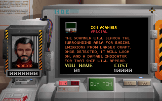
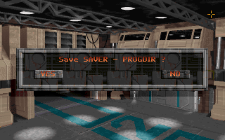
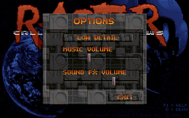
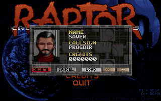


## Observed 2 November 2026: sound (step 4)

Commit `b55c304` (patches 0001 to 0004), Cradle `stove_build`, open4:
executable SHA-256
`2611a0e3bfbe4fb48530746197e127a7f527111f1e8c3ad3d3b882c6a190c31e`
(`receipts/4-audio-open4-stove_build.json`). Same lab (muted) and
`SDL2.module`; two runs of the program in 14 minutes, three games flown,
no stop.

- SDL opened AHI: `Audio: ahi, 44100 Hz, 2 channel(s), 512 samples a
  buffer`. The lab is muted, so nothing was heard; what is measured is
  that the stream was opened and fed in time.
- Steady flight (23.3 frames a second): 430 to 432 buffers every five
  seconds, none late, with 30 to 37 % of the time in the mixer (the OPL3
  emulation is most of it).
- Busy moments (a damaged ship with many explosions, 12 to 20 frames a
  second): the mixer took up to 66 % of the time and fell behind, 323 to
  410 buffers in five seconds, so the sound would stutter there.
- Intro, menus and hangar: 26 to 55 % in the mixer; the buffers were all
  mixed (the counts over longer periods match 86 a second).
- Quit with sound on: the program ended and left no task, and the lab went
  on (both runs).
- `SDL_AUDIODRIVER=dummy` (the step 3 build): a game played to the end and
  quit cleanly, the same as with AHI.

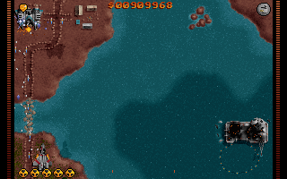

## Observed 2 November 2026: input and the first wave (step 3)

Commit `2fe304a` (patches 0001 to 0003), Cradle `stove_build`, open4:
executable SHA-256
`31e5954b43d7f58cd6667299199032e6064b592996d3b0e3ffedbbd7e6fc8355`
(`receipts/3-input-open4-stove_build.json`); `tests/lab` built HoldKeys.
Same lab and `SDL2.module` as step 2, `PROGDIR:User` cleared first.

- Keyboard in menus: Return on New Mission, the name and callsign typed
  into the pilot form, Up and Return for the difficulty (Rookie), Escape out
  of the credits and the hangar, the quit question answered with Return.
  The mouse pointer works the hangar (Fly Mission) and the sector list.
- Flight, Bravo Sector wave 1, Rookie: the ship flown with the keyboard
  through HoldKeys (Ctrl held to fire, Left and Right in turn), enemies shot
  down and the money rising ($10,000 to $16,050); Escape gives "Abort
  Mission ?", Return answers No and the flight goes on, Yes goes back to the
  hangar. Driven blind like this the ship was shot down after 45 to 100
  seconds each time, which ends the game as it should (back to the title
  menu).
- Wave 1 to its end: with upstream's developer mode (`Set S_HOST CASTLE`
  before starting, the original game's invulnerable test mode, which also
  fills the money and the weapons) the ship flew all of wave 1, between four
  and five minutes, and the game went back to the hangar; Fly Mission then
  started wave 2 (a new map). That run used the step 4 build (`b55c304`,
  which adds only the sound statistics and a sleep in the frame wait to
  this one) and is a check of the wave's length and its end, not a fair
  completion by a player.
- Frame rate in flight: 23.3 frames a second, the game's own pace (its
  loop draws a frame every third tick of its 70 Hz clock).
- Pads: GFOpenInput's port-2 stick is found and opened
  (`Pad 0: Amiga joystick port (2): joystick`). No stick or pad press can be
  sent from the lab tools, so pad play, the CD32 Back chord and the pad
  menus are not yet exercised.
- Twice with this build the whole lab stopped (screen frozen, no input, the
  agent silent, the processor idle): once answering the quit question after
  a game, once in flight after about 100 seconds. A reset brought it back.
  The cause is not established; it was not seen in the next 14 minutes
  with the step 4 build (7 of them in flight, sound on; see step 4).

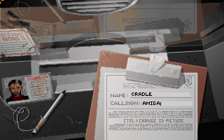

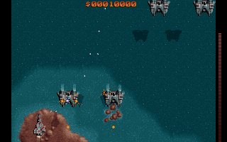

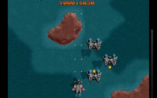

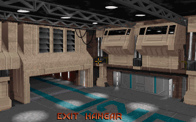
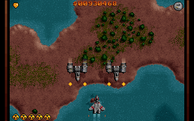

## Observed 2 November 2026: presentation (step 2)

Lab `lab:raptor`, a copy of Instance-32 (Kickstart 47, 68040 + 68882 under
Cradle's AC090 runtime, AGA plus the RTG board, opengpu.library 0.22, muted),
with gfopenrtg `main`'s `SDL2.module` (210df77, SHA-256 `afba9671...`) in
both `LIBS:OpenGPU/` and `LIBS:GFOpenGPU/`. Commit `23f37e8` (patches 0001
and 0002), Cradle `stove_build`, open4: executable SHA-256
`d6e5050c878c22e4b048b7122eb95dbb5b5b15b7ca9cbd4ae41c136e5197ec13`
(`receipts/2-presentation-open4-stove_build.json`). Started from `RAM:`
as `SYS:Raptor/raptor`, with no `PROGDIR:User` beforehand.

- The data was found in `PROGDIR:` and `PROGDIR:User/SETUP.INI` written
  with the Amiga defaults; no setup screen. SDL put the window surface in
  video RAM (`OS3_FB: window surface in video RAM (320x200)`).
- The intro and the title menu fill a 320x200 screen of their own, whole
  and clean (pictures below, as the screen showed them).
- Alt+Return: a 320x200 Workbench window with the frame drawn at once, and
  back to the screen of its own.
- Quit > Yes: the order screen, then upstream's text-mode ending screen in
  a window; a key ends the program, which left no task and no screen.


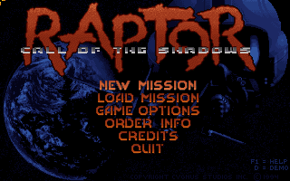

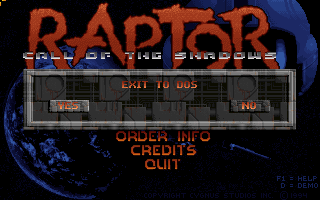
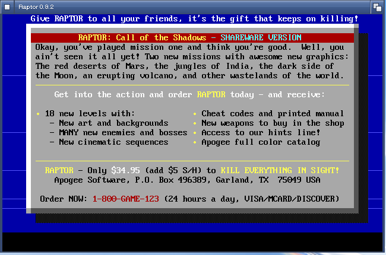

The first build of this step (`3394852`) left the menu grey in the window
after Alt+Return until a key was pressed, and spun the processor waiting
for the game's next 70 Hz tick; `23f37e8` fixes both.

## Observed 2 November 2026: build (step 1)

Clean build by Cradle's `stove_build` (target `.`, `os32-gcc16` stove,
OpenAmigaGCC 16.2.0-open4) of commit `f8ddda3`, no patches yet: upstream's
source compiles and links for 68040 + FPU with no warning. Executable
SHA-256 `723be964eacc4c39eb2f883f8e2ddea53e2ec412a99b6275f2a7072e5cec05d2`
(855476 bytes); `receipts/1-build-open4-stove_build.json`. A second job at
the same commit gave the same executable and the same receipt, byte for
byte. Target
`runtime-data` fetched the pinned ZIP on the PC and staged both GLB files,
each matching its pin (`receipts/1-data.json`).

No runtime claim is made by this step. This is TESTING, not RELEASE.
